Problem Set 1
================
Romero Moura

``` r
library(tidyverse)
```

    ## Warning: package 'ggplot2' was built under R version 4.3.3

    ## Warning: package 'purrr' was built under R version 4.3.3

    ## Warning: package 'lubridate' was built under R version 4.3.3

    ## ── Attaching core tidyverse packages ──────────────────────── tidyverse 2.0.0 ──
    ## ✔ dplyr     1.1.4     ✔ readr     2.1.5
    ## ✔ forcats   1.0.0     ✔ stringr   1.5.1
    ## ✔ ggplot2   3.5.2     ✔ tibble    3.2.1
    ## ✔ lubridate 1.9.4     ✔ tidyr     1.3.1
    ## ✔ purrr     1.0.4     
    ## ── Conflicts ────────────────────────────────────────── tidyverse_conflicts() ──
    ## ✖ dplyr::filter() masks stats::filter()
    ## ✖ dplyr::lag()    masks stats::lag()
    ## ℹ Use the conflicted package (<http://conflicted.r-lib.org/>) to force all conflicts to become errors

``` r
set.seed(0914)
```

Question 1)

1)  first lets get the distribution needed using r norm. 100
    observations with a mean of 0 and a sd of 2. sample variance =
    4.174892. sample sd = 2.043255.

``` r
en_oh_two <- rnorm(100, 0, 2)
var(en_oh_two)
```

    ## [1] 4.770781

``` r
sd(en_oh_two)
```

    ## [1] 2.184212

# now to create and run population variance function. Using population formula we get variance = 4.133143

``` r
pop_var <- function(x) {
  n = length(x)
  sum((x - mean(x))^2) / length(x)
}
  
pop_var(en_oh_two)
```

    ## [1] 4.723073

now lets run it using a simulated sample of 10 observations. This gives
us variance = 3.870828

``` r
check <- rnorm(10, 0, 2)

pop_var(check)
```

    ## [1] 4.409535

1.B) get the distribution then apply the function. Population variance
of sample is in df q1b.vp.

``` r
q1b <- replicate(1000, rnorm(5, 0, 2))

# wait but now this is inverted. transpose?

q1b <- t(q1b)

# ok. now create new df with pop-var for each row
q1b.vp  <- data.frame(pop.var  = apply(q1b, 1, pop_var))
```

Now plotting the sampling distribution of both measures. Plot is below.
True variance is marked by solid black line while dashed blue line shows
variance derived from population formula. It is to the left of the true
variance

``` r
ggplot(data = q1b.vp, mapping = aes(x = pop.var)) +
  geom_histogram(fill = 'lavender') +
  geom_vline(xintercept = 4, colour = 'black', linetype = 'solid') +
  geom_vline(xintercept = mean(q1b.vp$pop.var), colour = 'blue', linetype = 'dashed') +
  geom_density(colour = "black", size = 1) +
  labs("Note: Solid black line = true variance. Dashed blue line = population variance.") +
  theme_classic()
```

    ## Warning: Using `size` aesthetic for lines was deprecated in ggplot2 3.4.0.
    ## ℹ Please use `linewidth` instead.
    ## This warning is displayed once every 8 hours.
    ## Call `lifecycle::last_lifecycle_warnings()` to see where this warning was
    ## generated.

    ## `stat_bin()` using `bins = 30`. Pick better value with `binwidth`.

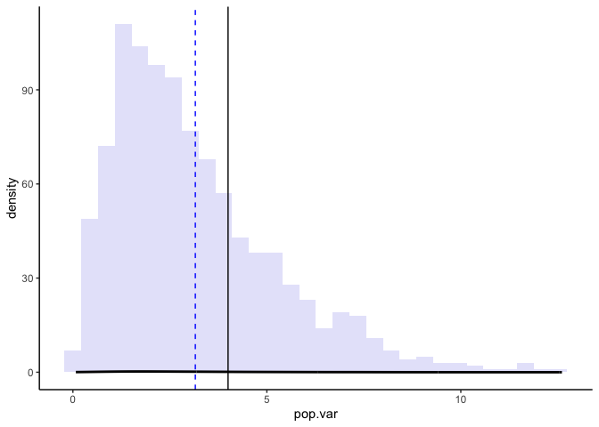<!-- -->

Meanwhile, graph of distribution of variance values derived from sample
formula is below. Dashed line is VERY close to the true variance. We can
safely conclude that the most biased estimator is the population
variance formula. It has negative bias.

``` r
q1b.vp2 <- data.frame(samp.var = apply(q1b, 1, var))

# plot
ggplot(data = q1b.vp2, mapping = aes(x = samp.var)) +
  geom_histogram(fill = 'lavender') +
  geom_vline(xintercept = 4, colour = 'black', linetype = 'solid') +
  geom_vline(xintercept = mean(q1b.vp2$samp.var), colour = 'blue', linetype = 'dashed') +
  geom_density(colour = "black", size = 1) +
  labs("Note: Solid black line = true variance. Dashed blue line = sample variance.") +
  theme_classic()
```

    ## `stat_bin()` using `bins = 30`. Pick better value with `binwidth`.

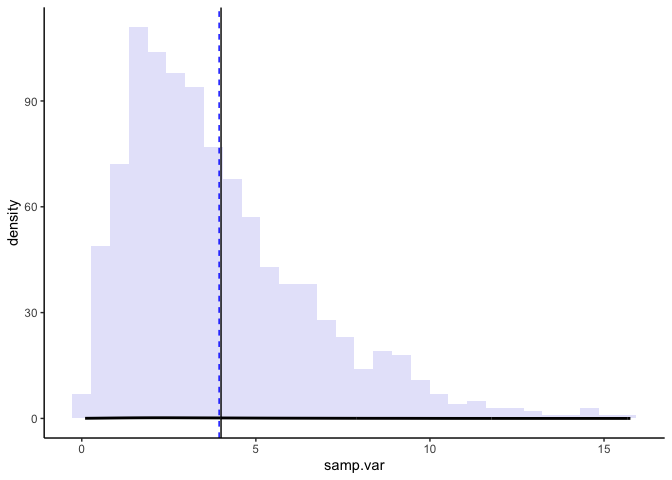<!-- -->

1.C) 3, 5, 10, 30, 100. Scatterplot below. Estimated bias decreases as
sample size increases

``` r
three <- replicate(3, rnorm(5, 0, 2))
five <- replicate(5, rnorm(5, 0, 2))
ten <- replicate(10, rnorm(5, 0, 2))
thirty <- replicate(30, rnorm(5, 0, 2))
hundred <- replicate(1000, rnorm(5, 0, 2))

three.vp  <- data.frame(pop.var  = apply(three, 1, pop_var))
vp.3.av <- data.frame(mean(three.vp$pop.var))
vp.3.av$size <- 3
vp.3.av$bias <- vp.3.av$mean.three.vp.pop.var. - 4

five.vp  <- data.frame(pop.var  = apply(five, 1, pop_var))
vp.5.av <- data.frame(mean(five.vp$pop.var))
vp.5.av$size <- 5
vp.5.av$bias <- vp.5.av$mean.five.vp.pop.var. - 4

ten.vp  <- data.frame(pop.var  = apply(ten, 1, pop_var))
vp.10.av <- data.frame(mean(ten.vp$pop.var))
vp.10.av$size <- 10
vp.10.av$bias <- vp.10.av$mean.ten.vp.pop.var. - 4

thirty.vp  <- data.frame(pop.var  = apply(thirty, 1, pop_var))
vp.30.av <- data.frame(mean(thirty.vp$pop.var))
vp.30.av$size <- 30
vp.30.av$bias <- vp.30.av$mean.thirty.vp.pop.var. - 4

hundred.vp  <- data.frame(pop.var  = apply(hundred, 1, pop_var))
vp.100.av <- data.frame(mean(hundred.vp$pop.var))
vp.100.av$size <- 100
vp.100.av$bias <- vp.100.av$mean.hundred.vp.pop.var. - 4

# need to standardize the names of popvar columns
names(vp.3.av)[1]   <- "mean.popvar"
names(vp.5.av)[1]   <- "mean.popvar"
names(vp.10.av)[1]  <- "mean.popvar"
names(vp.30.av)[1]  <- "mean.popvar"
names(vp.100.av)[1] <- "mean.popvar"

pop_var_graph_data <- rbind(vp.3.av, vp.5.av, vp.10.av, vp.30.av, vp.100.av)

# finally we plot now
ggplot(data = pop_var_graph_data, mapping = aes(x = size, y = bias)) +
  geom_point(colour = 'purple') +
  labs(x = "Sample Size", y = "Estimated Bias") +
  theme_classic()
```

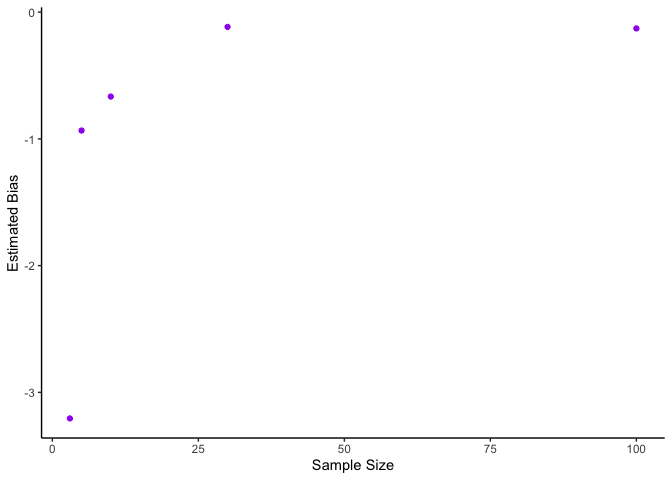<!-- --> 1.D) s is not
perfectly unbiased, but its estimated bias is very low, especially when
compared to the previous measure.

``` r
three.sd  <- data.frame(sd  = apply(three, 1, sd))
sd.3.av <- data.frame(mean(three.sd$sd))
sd.3.av$size <- 3
sd.3.av$bias <- sd.3.av$mean.three.sd.sd. - 2


five.sd  <- data.frame(sd  = apply(five, 1, sd))
sd.5.av <- data.frame(mean(five.sd$sd))
sd.5.av$size <- 5
sd.5.av$bias <- sd.5.av$mean.five.sd.sd. - 2


ten.sd  <- data.frame(sd  = apply(ten, 1, sd))
sd.10.av <- data.frame(mean(ten.sd$sd))
sd.10.av$size <- 10
sd.10.av$bias <- sd.10.av$mean.ten.sd.sd. - 2

thirty.sd  <- data.frame(sd  = apply(thirty, 1, sd))
sd.30.av <- data.frame(mean(thirty.sd$sd))
sd.30.av$size <- 30
sd.30.av$bias <- sd.30.av$mean.thirty.sd.sd. - 2

hundred.sd  <- data.frame(sd  = apply(hundred, 1, sd))
sd.100.av <- data.frame(mean(hundred.sd$sd))
sd.100.av$size <- 100
sd.100.av$bias <- sd.100.av$mean.hundred.sd.sd. - 2

# bind then plot
names(sd.3.av)[1]   <- "mean.sd"
names(sd.5.av)[1]   <- "mean.sd"
names(sd.10.av)[1]  <- "mean.sd"
names(sd.30.av)[1]  <- "mean.sd"
names(sd.100.av)[1] <- "mean.sd"

sd_bind <- rbind(sd.3.av, sd.5.av, sd.10.av, sd.30.av, sd.100.av)

ggplot(data = sd_bind, mapping = aes(x = size, y = bias)) +
  geom_point(colour = 'purple') +
  labs(x = "Sample Size", y = "Estimated Bias") +
  theme_classic()
```

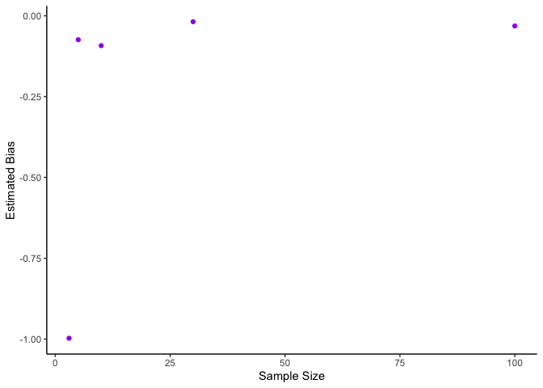<!-- -->

1.E) When comparing the standard deviation of the variance estimators,
it becomes clear that the population formula presents less variation.
Still, this does not make it a superior estimator, because it contains
much higher bias. While this estimator is more consistent, the sample
formula clusters around the same mean as our parameter as both measures’
sample size increases.

``` r
sd(q1b.vp$pop.var)
```

    ## [1] 2.131697

``` r
sd(q1b.vp2$samp.var)
```

    ## [1] 2.664621

2.A) Dataset generated below. Distributions checked with hist() command.
Correlation between xi and z in dataset is 0.492086.

``` r
# true model
rho <- 0.5
z <- rnorm(100, 0, 1)
ui <- rnorm(100, 0, 1)
ei <- rnorm(100, 0, 1)

b0 <- 1
b1 <- 2
b2 <- 3

b1_true <- 2

xi <- rho * z + sqrt(1-rho^2) * ui
yi <- b0 + b1*xi + b2*z + ei

# check distributions
hist(z)
```

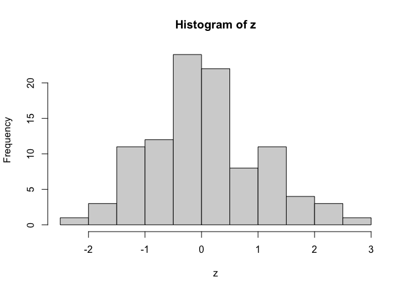<!-- -->

``` r
hist(ui)
```

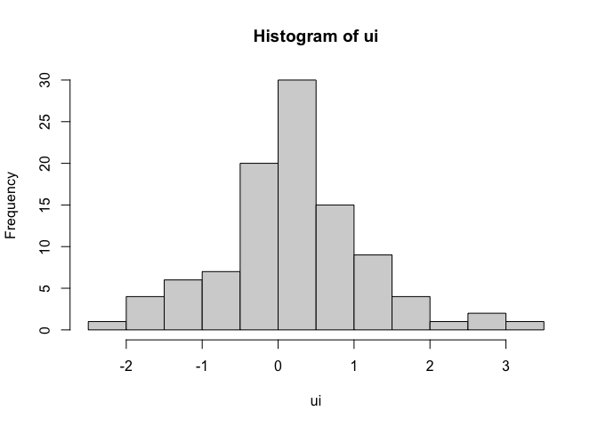<!-- -->

``` r
hist(ei)
```

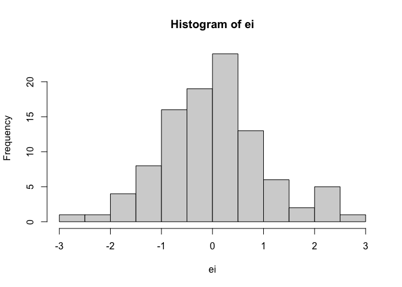<!-- -->

``` r
hist(xi)
```

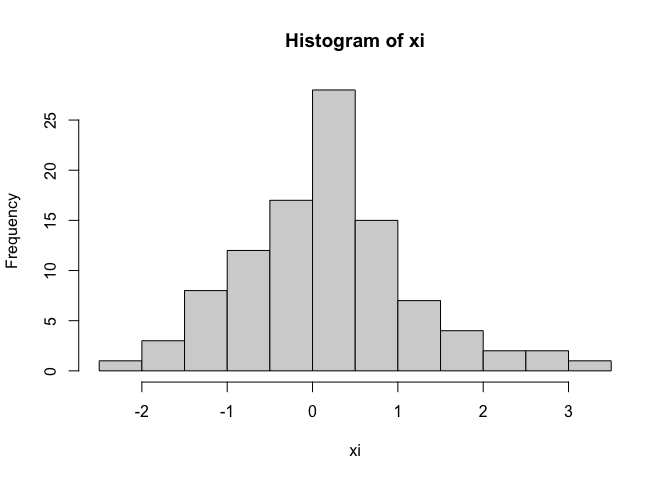<!-- -->

``` r
hist(yi)
```

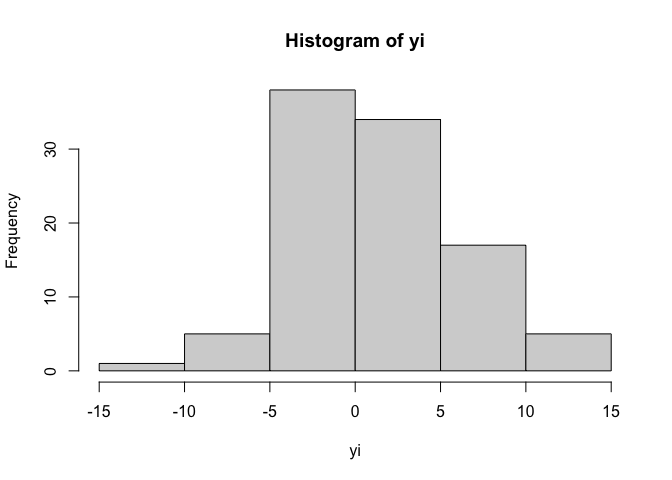<!-- -->

``` r
cor(xi, z)
```

    ## [1] 0.5789542

2.B) Comparing findings from both models, it becomes clear that news
consumption is positively associated with political knowledge at a
statistically significant level. However, once we account for Political
Interest (z), the coefficient for news consumption becomes smaller.
Political Interest’s effect size is also larger than news consumption’s.
In addition, ccounting for Interest greatly improveed the model’s fit,
since it’s R-squared increased from 0.53 to 0.93. The second model’s
coefficeints are also much closer to the estimand.

``` r
# lets fit both models!
# first theorized mdoel
theorized_model <- lm(yi ~ xi)
summary(theorized_model)
```

    ## 
    ## Call:
    ## lm(formula = yi ~ xi)
    ## 
    ## Residuals:
    ##    Min     1Q Median     3Q    Max 
    ## -6.226 -1.673  0.028  1.849  5.337 
    ## 
    ## Coefficients:
    ##             Estimate Std. Error t value Pr(>|t|)    
    ## (Intercept)   0.8067     0.2625   3.073  0.00274 ** 
    ## xi            3.6772     0.2587  14.215  < 2e-16 ***
    ## ---
    ## Signif. codes:  0 '***' 0.001 '**' 0.01 '*' 0.05 '.' 0.1 ' ' 1
    ## 
    ## Residual standard error: 2.583 on 98 degrees of freedom
    ## Multiple R-squared:  0.6734, Adjusted R-squared:  0.6701 
    ## F-statistic: 202.1 on 1 and 98 DF,  p-value: < 2.2e-16

``` r
true_model <- lm(yi ~ xi + z)
summary(true_model)
```

    ## 
    ## Call:
    ## lm(formula = yi ~ xi + z)
    ## 
    ## Residuals:
    ##      Min       1Q   Median       3Q      Max 
    ## -2.82363 -0.65700  0.00307  0.58558  2.52826 
    ## 
    ## Coefficients:
    ##             Estimate Std. Error t value Pr(>|t|)    
    ## (Intercept)   1.0188     0.1044   9.754 4.56e-16 ***
    ## xi            2.0062     0.1257  15.954  < 2e-16 ***
    ## z             2.8504     0.1242  22.952  < 2e-16 ***
    ## ---
    ## Signif. codes:  0 '***' 0.001 '**' 0.01 '*' 0.05 '.' 0.1 ' ' 1
    ## 
    ## Residual standard error: 1.024 on 97 degrees of freedom
    ## Multiple R-squared:  0.9492, Adjusted R-squared:  0.9482 
    ## F-statistic: 906.5 on 2 and 97 DF,  p-value: < 2.2e-16

``` r
models_plot_df <- data_frame(xi, yi, z)
```

    ## Warning: `data_frame()` was deprecated in tibble 1.1.0.
    ## ℹ Please use `tibble()` instead.
    ## This warning is displayed once every 8 hours.
    ## Call `lifecycle::last_lifecycle_warnings()` to see where this warning was
    ## generated.

``` r
xy_plot <- ggplot(data = models_plot_df, mapping = aes(x = xi, y = yi)) +
  geom_point() +
  theme_bw() + 
  xlab('News Consumption') + 
  ylab('Political Knowledge')

xy_plot
```

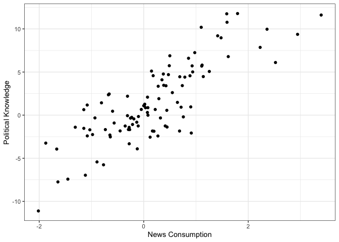<!-- -->

2.C) More data brought the true model’s B1 coefficient closer to the
estimand. While more data also brought the theorized model’s B1
coefficient slightly closer to the estimand, it was still far from it.
In other words, it remained biased.

``` r
z_2 <- rnorm(1000, 0, 1)
ui_2 <- rnorm(1000, 0, 1)
ei_2 <- rnorm(1000, 0, 1)


xi_2 <- rho * z_2 + sqrt(1-rho^2) * ui_2
yi_2 <- b0 + b1*xi_2 + b2*z_2 + ei_2

# check distributions
hist(z_2)
```

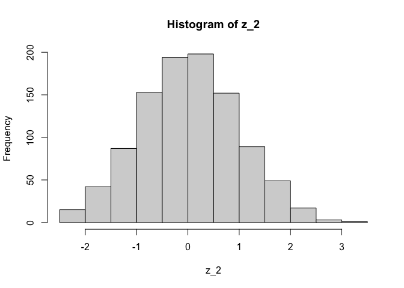<!-- -->

``` r
hist(ui_2)
```

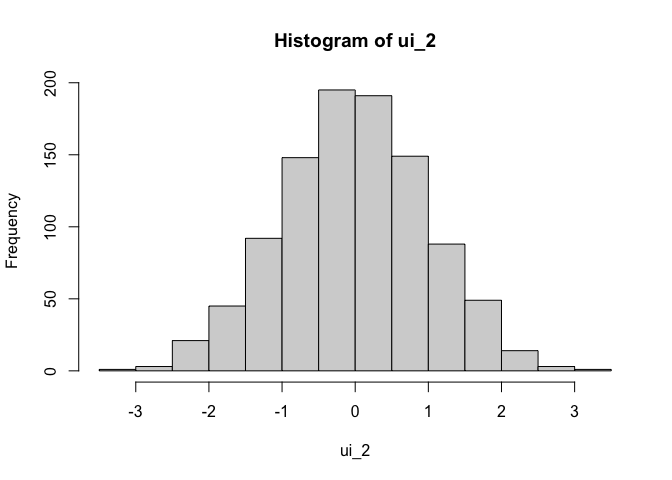<!-- -->

``` r
hist(ei_2)
```

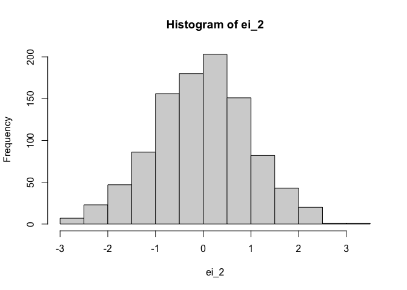<!-- -->

``` r
hist(xi_2)
```

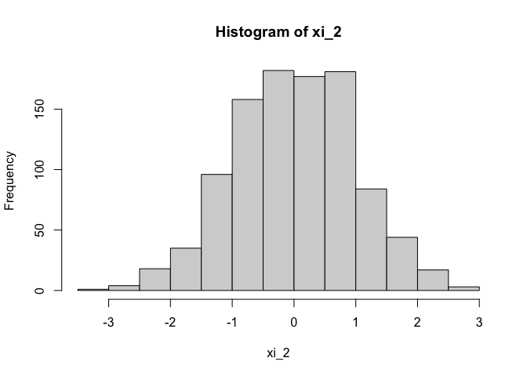<!-- -->

``` r
hist(yi_2)
```

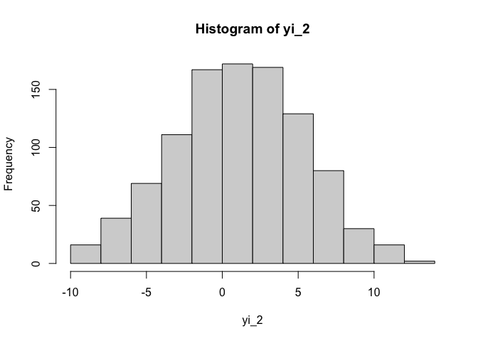<!-- -->

``` r
cor(xi_2, z_2)
```

    ## [1] 0.4694417

``` r
# models
theorized_model_2 <- lm(yi_2 ~ xi_2)
summary(theorized_model_2)
```

    ## 
    ## Call:
    ## lm(formula = yi_2 ~ xi_2)
    ## 
    ## Residuals:
    ##     Min      1Q  Median      3Q     Max 
    ## -7.8001 -1.8976 -0.0383  1.8736  9.0733 
    ## 
    ## Coefficients:
    ##             Estimate Std. Error t value Pr(>|t|)    
    ## (Intercept)  1.07725    0.08546   12.61   <2e-16 ***
    ## xi_2         3.39070    0.08766   38.68   <2e-16 ***
    ## ---
    ## Signif. codes:  0 '***' 0.001 '**' 0.01 '*' 0.05 '.' 0.1 ' ' 1
    ## 
    ## Residual standard error: 2.703 on 998 degrees of freedom
    ## Multiple R-squared:  0.5999, Adjusted R-squared:  0.5995 
    ## F-statistic:  1496 on 1 and 998 DF,  p-value: < 2.2e-16

``` r
true_model_2 <- lm(yi_2 ~ xi_2 + z_2)
summary(true_model_2)
```

    ## 
    ## Call:
    ## lm(formula = yi_2 ~ xi_2 + z_2)
    ## 
    ## Residuals:
    ##      Min       1Q   Median       3Q      Max 
    ## -2.90286 -0.69577  0.04192  0.67334  3.07498 
    ## 
    ## Coefficients:
    ##             Estimate Std. Error t value Pr(>|t|)    
    ## (Intercept)  0.97170    0.03162   30.73   <2e-16 ***
    ## xi_2         2.02250    0.03670   55.11   <2e-16 ***
    ## z_2          2.96404    0.03732   79.42   <2e-16 ***
    ## ---
    ## Signif. codes:  0 '***' 0.001 '**' 0.01 '*' 0.05 '.' 0.1 ' ' 1
    ## 
    ## Residual standard error: 0.9989 on 997 degrees of freedom
    ## Multiple R-squared:  0.9454, Adjusted R-squared:  0.9453 
    ## F-statistic:  8629 on 2 and 997 DF,  p-value: < 2.2e-16

2.D) After repeating with rho = 0, the coefficient for B1 in the
simple/theorized model is much closer to its actual value. In addition,
the inclusion of z in the model did not alter the B1 coefficient or its
level of statistical significance. Still, the R-squared is lower in the
naive model. This means that, when constructing regression models, we
should be very careful about our choice of control variables. As
demonstrated here, including a control variable that has no correlation
with x, and thus one which cannot serve as a confounding variable, but
is still related to y could improve model fit but will have no impact on
our variable of interest. This decision should depend on the
researcher’s objectives. Someone who is looking for higher precision
would want to include the uncorrelated controls, while those who are
primarily concerned about x’s impact on y may not be well-served by
including the set of controls.

``` r
rho_2 <- 0

xi_3 <- rho_2 * z_2 + sqrt(1-rho_2^2) * ui_2
yi_3 <- b0 + b1*xi_3 + b2*z_2 + ei_2

theorized_model_3 <- lm(yi_3 ~ xi_3)
summary(theorized_model_3)
```

    ## 
    ## Call:
    ## lm(formula = yi_3 ~ xi_3)
    ## 
    ## Residuals:
    ##     Min      1Q  Median      3Q     Max 
    ## -7.9115 -2.1274  0.0526  2.1633  9.0946 
    ## 
    ## Coefficients:
    ##             Estimate Std. Error t value Pr(>|t|)    
    ## (Intercept)  1.08839    0.09563   11.38   <2e-16 ***
    ## xi_3         1.94737    0.09617   20.25   <2e-16 ***
    ## ---
    ## Signif. codes:  0 '***' 0.001 '**' 0.01 '*' 0.05 '.' 0.1 ' ' 1
    ## 
    ## Residual standard error: 3.024 on 998 degrees of freedom
    ## Multiple R-squared:  0.2912, Adjusted R-squared:  0.2905 
    ## F-statistic: 410.1 on 1 and 998 DF,  p-value: < 2.2e-16

``` r
true_model_3 <- lm(yi_3 ~ xi_3 + z_2)
summary(true_model_3)
```

    ## 
    ## Call:
    ## lm(formula = yi_3 ~ xi_3 + z_2)
    ## 
    ## Residuals:
    ##      Min       1Q   Median       3Q      Max 
    ## -2.90286 -0.69577  0.04192  0.67334  3.07498 
    ## 
    ## Coefficients:
    ##             Estimate Std. Error t value Pr(>|t|)    
    ## (Intercept)  0.97170    0.03162   30.73   <2e-16 ***
    ## xi_3         2.01949    0.03178   63.55   <2e-16 ***
    ## z_2          2.97529    0.03296   90.26   <2e-16 ***
    ## ---
    ## Signif. codes:  0 '***' 0.001 '**' 0.01 '*' 0.05 '.' 0.1 ' ' 1
    ## 
    ## Residual standard error: 0.9989 on 997 degrees of freedom
    ## Multiple R-squared:  0.9227, Adjusted R-squared:  0.9226 
    ## F-statistic:  5952 on 2 and 997 DF,  p-value: < 2.2e-16
